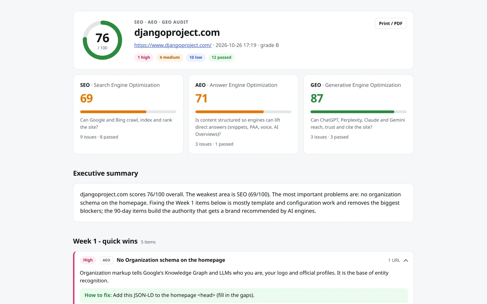
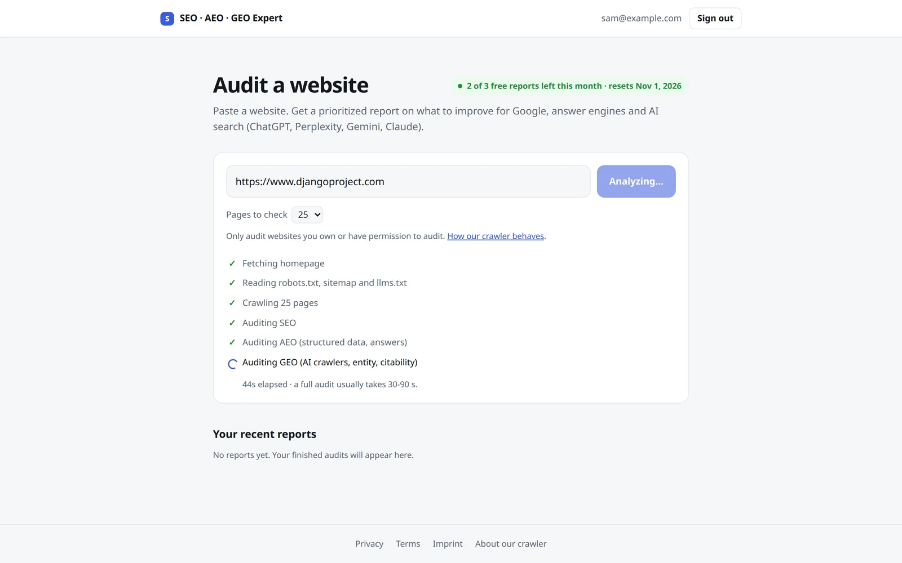
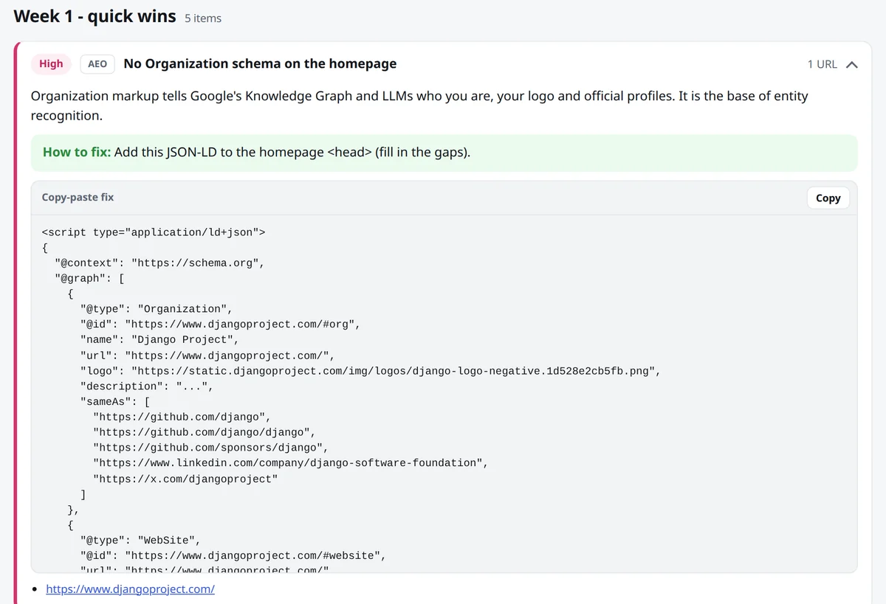
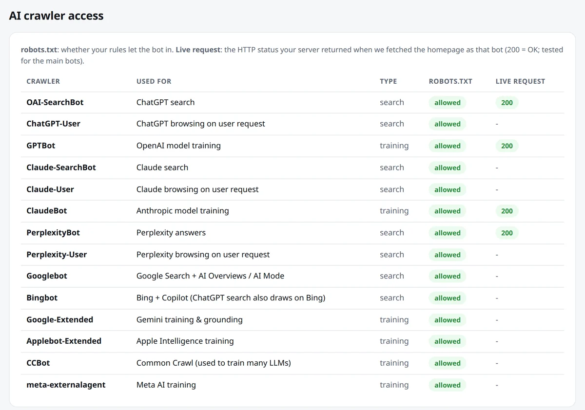

# SEO / AEO / GEO website audit

Paste a website address. About a minute later you get one report that says what to fix so the site
ranks in Google, gets quoted by answer engines and gets cited by AI search (ChatGPT, Perplexity,
Gemini, Claude). Every issue comes with a ready-to-paste fix and a place in a Week 1 / 30-day / 90-day plan.



| A live audit, step by step | A copy-paste fix for each issue |
|---|---|
|  |  |



*Screenshots: a real audit of djangoproject.com on 2026-10-26, run locally.*

**What it is:** a FastAPI web app with email sign-in, a monthly free quota and private reports, plus a
command-line version of the same pipeline. Python does the crawling and the checks. Claude Code agents
(`.claude/agents/`) do the deeper analysis when run from the terminal. Free data sources only; an LLM is optional.

The project follows the **WAT framework** (Workflows → Agents → Tools). See [CLAUDE.md](CLAUDE.md).

## Setup

```bash
python3 -m venv .venv
source .venv/bin/activate
pip install -r requirements.txt
cp .env.example .env             # then fill in the keys you want (all optional)
python tools/check_setup.py      # add --live to test the PageSpeed API
```

## Web app (quick start)

```bash
.venv/bin/uvicorn app.server:app --host 127.0.0.1 --port 8000
```

Open http://127.0.0.1:8000, paste a URL and start the analysis. The report contains:

- SEO, AEO and GEO scores (plus overall) with an executive summary
- A prioritized roadmap: Week 1 quick wins / Next 30 days / Next 90 days
- Copy-paste fixes: JSON-LD schema, robots.txt rules, an llms.txt draft
- An AI crawler table (robots.txt rules + live user-agent test per bot)
- An AI visibility test: does an LLM mention or cite the brand for buyer questions?
- Downloads: the HTML report and a Markdown action plan

CLI, same pipeline: `python tools/analyze_site.py https://example.com [--max-pages 25] [--no-pagespeed] [--no-llm]`.
Reports land in `.tmp/jobs/<id>/` (web app) and `.tmp/<domain>/` (CLI). SOP: [workflows/site_analysis.md](workflows/site_analysis.md).

## Layout

```
workflows/   Markdown SOPs (start from workflows/_template.md)
tools/       Python scripts that do the work (python tools/<script>.py)
app/         FastAPI web app (server.py) + static UI (static/index.html)
templates/   Jinja2 HTML report template (report.html.j2)
.tmp/        Disposable intermediates
.env         API keys (gitignored); documented in .env.example
credentials.json / token.json   Google OAuth (gitignored)
```

Deliverables go to Google Sheets/Slides, except the web app's HTML report and Markdown action plan, which are accepted deliverables as-is.

## Data sources (free first)

| Source | Used for | Cost / key |
|--------|----------|------------|
| Direct crawling (requests, BeautifulSoup, advertools) | On-page, robots.txt, sitemaps, internal links | Free, no key |
| extruct | Schema / JSON-LD / OpenGraph audit | Free, no key |
| DuckDuckGo (`ddgs`) | SERP & competitor discovery | Free, no key |
| PageSpeed Insights | Core Web Vitals, Lighthouse | Free key (`PAGESPEED_API_KEY`) |
| Google Search Console | Queries, clicks, impressions, indexing | Free, OAuth (`credentials.json`) |
| Google Sheets / Slides | Deliverables | Free, OAuth |
| Bing Webmaster Tools | Bing data (also feeds Copilot/ChatGPT search) | Free key |
| NVIDIA NIM (OpenAI-compatible API) | AI visibility test + report summary (default LLM) | Free dev tier, rate limited (`NVIDIA_API_KEY`) |
| Gemini / Groq free tiers, Ollama | LLM visibility checks (is the brand cited?) | Free tier / local |

Paid APIs (Anthropic, OpenAI, Perplexity, Firecrawl) are listed but commented out in `.env.example`. Only use them after explicit approval.

## Getting the free keys

- **PageSpeed**: Google Cloud console → enable "PageSpeed Insights API" → Credentials → API key.
- **Google OAuth**: same project → enable Search Console, Sheets, Slides APIs → OAuth client ID (Desktop) → save as `credentials.json`.
- **Bing**: bing.com/webmasters → Settings → API access.
- **NVIDIA NIM**: build.nvidia.com → pick a model → Get API Key. Optional `NVIDIA_MODEL` overrides the default model.
- **Gemini**: aistudio.google.com → Get API key.
- **Groq**: console.groq.com → API Keys.
- **Ollama**: install from ollama.com, then `ollama pull <model>`.
